# Disaster recovery across two regions

This page describes how to run CCX with a **warm standby** in a second region, and how to fail over to it when the primary region is lost.

The procedure covers the loss of the **whole primary Kubernetes cluster or region**. It is not the tool for smaller failures:

- A single CCX pod, node or ccxdeps database instance failing is handled by Kubernetes and the operators inside the cluster.
- A single customer datastore failing is handled by CCX itself (node replacement, or [restoring from a backup](../../user/Howto/Create-Datastore-From-Backup.md)).

:::note
The ArgoCD redeploy path in [Step ④](#step--deploy-ccx-on-the-standby) requires **`helm-ccx` 1.58.0 or later**; see [Deploying with ArgoCD](Deploying-with-ArgoCD.md). The Kubernetes resource backup in [Step ②](#step--back-up-to-s3) is a manual export today. **An automated backup job for these resources is coming in CCX 1.59.** Until then, run the export described below on a schedule of your own.
:::

## How it works

Select any diagram on this page to open it at full size. On each step diagram, the moving arrows show what that step does.

[](../images/dr/dr-overview.svg)

The setup spans three locations:

| Location | What runs there | State in normal operation |
|---|---|---|
| **Region A, primary cluster** | The full CCX control plane: `ccx` and `ccxdeps` Helm releases, ingress, cert-manager, external-dns. | Serves all traffic. Owns the DNS records. |
| **Region B, standby cluster** | Only the base platform: `ccxdeps` (with the ccxdb and cmon db databases), external-dns, cert-manager and an ingress controller. **No `ccx` release.** | Its ccxdb and cmon db are read-only replicas of the primary. Nothing else is active. |
| **Outside both regions** | S3-compatible object storage, and the DNS zone that ExternalDNS manages. | Receives backups and serves DNS. Must survive the loss of either region. |

In normal operation, two things keep the standby usable:

1. **Database replication (Step ①).** ccxdb and cmon db replicate continuously from the primary into the standby.
2. **Backups to S3 (Step ②).** Kubernetes resources that are not stored in the databases, plus the ccxdeps database and customer datastore backups, are written to S3 outside both regions.

When the primary region is lost, you fence the primary, **detach the replication** and promote the standby databases, restore the Kubernetes resources from S3 (Step ③), deploy CCX onto the standby (Step ④), and restore any datastores that CCX reports as missing (Step ⑤).

### How much you can lose

Each piece of state comes back from a different source, so each has its own recovery point:

| State | Restored from | Freshness at failover |
|---|---|---|
| CCX metadata (ccxdb) and cmon state (cmon db) | The promoted standby databases | As fresh as the replication lag at the moment of failure. Usually seconds. |
| cmon configuration secrets, `usr-*` Secrets, Services and Ingresses | The latest export in S3 | As fresh as the **last export run**. Anything created after it is missing. |
| Customer datastores lost with the region | Datastore backups in S3 | As fresh as each datastore's last backup. |

The export is the weakest link. Run it often (see [Step ②](#step--back-up-to-s3)).

## Requirements

Work through all of these before you set up the standby. Most failovers that go wrong fail on one of them.

**Clusters**

- Two Kubernetes clusters in **different regions**, with comparable capacity. The standby must be able to run the full CCX control plane after failover.
- The same **namespace** (this page uses `ccx`) and the same **`ccxdeps` release name** on both clusters. The `ccx` values reference the databases by in-cluster Service names. If those names match, the same values file works on both clusters without edits.
- The same ingress class, the same cert-manager `ClusterIssuer` name, and the storage classes that your `ccxdeps` values reference must exist on both clusters.

**Outside both regions**

- **S3-compatible storage** whose availability does not depend on either region. This applies to every bucket involved: the ccxdeps database backups, the Kubernetes resource exports, and the customer datastore backups (the `s3` settings of your cloud vendor in the `ccx` values). An object store that runs in region A, or a cloud provider's region-local S3 endpoint in region A, does **not** qualify.
- A **DNS zone** hosted by a provider that is independent of both regions.

**Network**

- A network path from the standby's databases to the primary's ccxdb and cmon db for replication. Encrypt it and restrict it to the two clusters.
- The CCX control plane connects to the datastore VMs. Allow the **standby cluster's egress IPs in advance**. Add them to the datastore security group (for example `ccx-common` on OpenStack) and to the CIDRs configured for CCX in the `ccx` values. If you only find out during a failover that CCX can't reach the datastores, every datastore will look unhealthy.

**Configuration and secrets**

- The `ccx` and `ccxdeps` values files for the primary, stored outside region A (a git repository, or the ArgoCD values repository).
- On the standby, pre-create the per-tenant secrets that the export does **not** include. These are the cloud provider credential secrets listed in `ccx.cloudSecrets`, the image pull secret, the S3 credential secrets and any license secrets; see [Deploying with ArgoCD → Prerequisites](Deploying-with-ArgoCD.md#prerequisites) for the list.
- **Database credentials must match.** Replication copies the database users and their passwords from the primary. The Kubernetes secrets that hold the ccxdb and cmon db credentials on the standby must contain the **same** passwords. Otherwise CCX can't log in to the promoted databases after failover.

**ExternalDNS ownership**

:::danger
With the default `ccxdeps` settings (`policy: sync`, no `txtOwnerId`), ExternalDNS on both clusters uses the same owner ID. The standby has no `usr-*` Services or Ingresses, so its ExternalDNS treats every record in the zone as stale and **deletes the primary's live DNS records**. This happens in normal operation, long before any disaster.

On the standby, before you enable ExternalDNS, set:

- `txtOwnerId` to **the same value as the primary**. If the primary doesn't set it, the value is `default`.
- `txtPrefix` and `domainFilters` to the same values as the primary.
- `policy: upsert-only`, so the standby can create and update records but never delete them.

You switch the standby to `policy: sync` during failover, in [Step ③](#step--restore-kubernetes-resources-on-the-standby).
:::

## Prepare the standby

### Install the base platform

On the standby cluster:

1. Install the ingress controller and cert-manager, with the same `ClusterIssuer` name as the primary.
2. Pre-create the secrets listed in [Requirements](#requirements).
3. Install `ccxdeps` with the primary's values, using the same release name and namespace, and with these standby overrides for ExternalDNS:

   ```yaml
   external-dns:
     enabled: true
     policy: upsert-only          # never delete records while in standby
     txtOwnerId: default          # MUST equal the primary's owner ID
     txtPrefix: ccx-              # same as the primary
     domainFilters:
       - ccx.example.org          # same as the primary
   ```

   ```bash
   helm upgrade --install ccxdeps s9s/ccxdeps -n ccx --create-namespace \
     -f ccxdeps-values.yaml -f ccxdeps-standby-overrides.yaml --wait
   ```

4. **Do not install the `ccx` release** on the standby, and do not create any `usr-*` resources there. A second running CCX control plane would manage the same datastores as the primary.

If you use ArgoCD, manage the standby's `ccxdeps` with its own `Application` pointing at the standby cluster. Keep the `ccx` Application pointing at the primary.

### Step ① Replicate ccxdb and cmon db {#step--replicate-ccxdb-and-cmon-db}

[](../images/dr/dr-step-1.svg)

The standby's databases must be continuous, read-only copies of the primary's.

| Database | Engine in `ccxdeps` | What the replication must provide |
|---|---|---|
| **ccxdb** | PostgreSQL, Zalando postgres-operator | The standby's Postgres cluster runs as a **standby cluster** of the primary, streaming from the primary or from its WAL archive. See the operator's [standby cluster documentation](https://postgres-operator.readthedocs.io/en/latest/user/#setting-up-a-standby-cluster). |
| **cmon db** | MySQL InnoDB Cluster, MySQL Operator | The standby's InnoDB Cluster receives an **asynchronous, GTID-based replication channel** from the primary's InnoDB Cluster. The standby stays `super_read_only`. See the MySQL documentation on [replication channels](https://dev.mysql.com/doc/refman/8.4/en/replication-channels.html). |

Whatever tooling you use, the replication must meet these requirements:

- **It covers everything CCX stores.** Replicate the whole instance, not individual tables.
- **The standby stays read-only** until you deliberately promote it. Nothing may write to the standby databases in normal operation.
- **It is monitored.** Alert on replication lag and on a stopped replication channel. A standby that silently stopped replicating weeks ago gives you weeks of data loss at failover.
- **You know how to detach it.** Write down, for your environment, the exact commands that stop the replication and promote each standby database. You run them under pressure in [Detach the replication](#detach-the-replication).

:::warning
Replication is not a backup. A `DROP` or a bad migration on the primary replicates to the standby within seconds. Keep the ccxdeps database backups from Step ② running as well.
:::

### Step ② Back up to S3 {#step--back-up-to-s3}

[](../images/dr/dr-step-2.svg)

Three kinds of backup go to S3 outside both regions.

#### ccxdeps database backups

Configure scheduled backups of the ccxdb and cmon db databases as described in [CCX data backups](CCX%20data%20backups.md). Point them at a bucket outside both regions.

These backups protect against what replication can't: data that was deleted or corrupted on the primary and replicated to the standby.

If the standby runs `ccxdeps` with the same values, its backup schedules also run, against the read-only replica. Give the standby a different bucket **prefix**, or disable the schedules on the standby until failover. Otherwise both clusters write to the same location.

#### Customer datastore backups

Datastore backups are configured per cloud vendor with the `s3` settings in the `ccx` values. Make sure the endpoint is outside both regions. These are the backups you restore from in [Step ⑤](#step--restore-missing-datastores).

#### Kubernetes resource export

Some of the state CCX needs isn't stored in ccxdb or cmon db. It lives as Kubernetes objects in the CCX namespace:

| Kind | Objects | Why they matter |
|---|---|---|
| Secret | `com.severalnines.cmon.etc.cmon.d.cmon-*` | cmon configuration for each managed cluster |
| Secret | `com.severalnines.cmon.var.lib.cmon.*` | cmon runtime state and keys |
| Secret | `usr-*` | Per-datastore credentials and keys |
| Secret | `tls-certificate-authority` | The CA that datastore certificates are issued from |
| Service | `usr-*` | `ExternalName` Services that ExternalDNS publishes as datastore hostnames |
| Ingress | `usr-*` | Per-datastore routes, for example metrics endpoints |

:::info
**Coming in CCX 1.59:** a built-in job that exports exactly these resources to S3 on a schedule. Until you can use it, run the export below yourself. The archive format is the same, so the restore procedure in Step ③ doesn't change.
:::

Run the following script against the **primary** cluster from a host outside region A. Typical options are a CI job, an ops host, or a CronJob in a third cluster. It needs `kubectl`, the `aws` CLI, `tar` and `gzip`.

```bash title="ccx-resource-export.sh"
#!/usr/bin/env bash
set -euo pipefail

NAMESPACE="ccx"
BUCKET="ccx-dr"                      # bucket outside both regions
PREFIX="k8s-resources"               # path inside the bucket
S3_ENDPOINT="${S3_ENDPOINT:-}"       # set for non-AWS S3, e.g. https://s3.example.com

WORKDIR="$(mktemp -d)"
trap 'rm -rf "$WORKDIR"' EXIT

export_kind() {
  local kind="$1" prefix="$2" pattern="$3" names
  # Fail loudly on API/RBAC errors; only "no match" is allowed to be empty.
  names="$(kubectl get "$kind" -n "$NAMESPACE" -o name)"
  grep -E "$pattern" <<< "$names" | while read -r res; do
    kubectl get "$res" -n "$NAMESPACE" -o yaml > "$WORKDIR/${prefix}-${res#*/}.yaml"
  done || true
}

export_kind secrets   secret  '^secret/(com\.severalnines\.cmon\.etc\.cmon\.d\.cmon-|com\.severalnines\.cmon\.var\.lib\.cmon\.|usr-|tls-certificate-authority$)'
export_kind services  service '^service/usr-'
export_kind ingresses ingress '^ingress\.networking\.k8s\.io/usr-'

echo "Exported $(find "$WORKDIR" -type f | wc -l) resource(s)."

ARCHIVE="ccx-resource-backup-${NAMESPACE}-$(date -u +%Y%m%dT%H%M%SZ).tar.gz"
tar -czf "/tmp/${ARCHIVE}" -C "$WORKDIR" .
aws s3 cp ${S3_ENDPOINT:+--endpoint-url "$S3_ENDPOINT"} "/tmp/${ARCHIVE}" "s3://${BUCKET}/${PREFIX}/${ARCHIVE}"
rm -f "/tmp/${ARCHIVE}"
```

- **How often:** at least daily, and ideally every hour or after every datastore is created or deleted. A datastore created after the last export comes back without its Secrets and DNS Service.
- **Security:** the archive contains Secrets (base64, not encrypted). Restrict the bucket to the DR operators, enable server-side encryption, and set a lifecycle rule that expires old exports.
- **Check it works:** list the newest archives and confirm the time of the last one:

  ```bash
  aws s3 ls s3://ccx-dr/k8s-resources/ | sort | tail -n 3
  ```

### Steady-state checklist

Review this regularly, and after every CCX upgrade:

- [ ] Replication lag for ccxdb and cmon db is low, and the alerting works.
- [ ] Standby databases are read-only.
- [ ] A recent Kubernetes resource export exists in S3.
- [ ] ccxdeps database backups and datastore backups are landing in buckets outside both regions.
- [ ] The standby's ExternalDNS runs with `policy: upsert-only` and the primary's owner ID. The zone still contains all of the primary's records.
- [ ] The standby has the per-tenant secrets, and the database credentials match the primary.
- [ ] The standby's egress IPs are allowed to reach the datastore VMs.
- [ ] The current `ccx` and `ccxdeps` values and chart versions are stored outside region A.
- [ ] If you use ArgoCD: ArgoCD itself runs outside region A, and the standby cluster is registered in it.

## Fail over

Follow these sections in order. Each one depends on the previous ones.

### Decide and fence the primary

Declare a disaster when the primary cluster or region is **down and not expected back within your recovery time objective**. Don't fail over for a short API outage or a single failed node. Failover is a one-way move, and coming back is a planned failback (see [After failover](#after-failover)).

Before you touch the standby, make sure the primary **can't come back on its own**:

- If any part of the primary is still reachable, scale down its CCX deployments and its external-dns:

  ```bash
  kubectl -n ccx scale deploy --all --replicas=0
  kubectl -n ccx scale statefulset cmon --replicas=0
  ```

- If you use ArgoCD, disable auto-sync for the primary's Applications, so ArgoCD doesn't scale them back up.
- If the primary is unreachable, stop it at the infrastructure level: power off its nodes or block its egress.

:::danger
If the old primary comes back while the standby is active, you have **two CCX control planes** managing the same datastores. The old primary's ExternalDNS, still in `policy: sync`, also reclaims the DNS records. Fence first, every time.
:::

### Detach the replication

[](../images/dr/dr-detach.svg)

**When:** after the primary is fenced, and **before** you restore anything or deploy CCX. CCX needs writable databases to start, and promoting before fencing risks two writable copies.

**Never** detach the replication in normal operation, for example "to test". A detached standby immediately diverges from the primary and has to be rebuilt from scratch.

Do this for both databases:

1. **Record the last replicated position** (Postgres replay LSN and timestamp; MySQL `Retrieved_Gtid_Set` and `Executed_Gtid_Set`). This is your evidence of how much data was lost.
2. **Stop the replication and promote.**
   - **ccxdb:** promote the standby Postgres cluster. With the Zalando operator, remove the `standby` section from the cluster manifest, and the operator promotes it.
   - **cmon db:** stop the replication channel from the primary, remove it, and make the InnoDB Cluster primary writable (turn off `super_read_only`).
3. **Verify that both are writable:**

   ```bash
   # ccxdb: must return "f" (not in recovery)
   kubectl exec -n ccx <ccxdb-pod> -- psql -U postgres -tAc 'SELECT pg_is_in_recovery();'

   # cmon db: must return 0, and SHOW REPLICA STATUS must return no rows
   kubectl exec -n ccx <cmon-db-pod> -- mysql -u root -p -e 'SELECT @@super_read_only; SHOW REPLICA STATUS\G'
   ```

### Step ③ Restore Kubernetes resources on the standby {#step--restore-kubernetes-resources-on-the-standby}

[](../images/dr/dr-step-3.svg)

Restore the export **only now, during a failover**. If the `usr-*` Services and Ingresses existed on the standby in normal operation, its ExternalDNS would publish the same hostnames as the primary, and both clusters would compete for them.

1. Download the newest archive:

   ```bash
   aws s3 ls s3://ccx-dr/k8s-resources/ | sort | tail -n 1
   aws s3 cp s3://ccx-dr/k8s-resources/<archive>.tar.gz .
   mkdir restore && tar -xzf <archive>.tar.gz -C restore
   ```

2. Remove the server-populated fields. The objects were exported from another cluster, so their `uid` and `resourceVersion` would be rejected. This uses [`yq`](https://github.com/mikefarah/yq) v4:

   ```bash
   for f in restore/*.yaml; do
     yq -i 'del(.metadata.uid, .metadata.resourceVersion, .metadata.creationTimestamp,
                .metadata.managedFields, .metadata.generation, .metadata.ownerReferences,
                .metadata.annotations."kubectl.kubernetes.io/last-applied-configuration",
                .status)' "$f"
   done
   ```

3. Apply the objects to the standby, in the CCX namespace:

   ```bash
   kubectl apply -n ccx -f restore/
   kubectl get secrets,svc,ingress -n ccx | grep -E 'usr-|cmon|tls-certificate-authority'
   ```

4. Hand DNS ownership to the standby. Switch its ExternalDNS from `upsert-only` to `sync`, so it also removes stale records from now on. Also change `policy` to `sync` in `ccxdeps-standby-overrides.yaml`, so a later upgrade doesn't switch it back:

   ```bash
   helm upgrade ccxdeps s9s/ccxdeps -n ccx -f ccxdeps-values.yaml \
     -f ccxdeps-standby-overrides.yaml --set external-dns.policy=sync --wait
   ```

5. Watch ExternalDNS pick up the restored objects, and check a datastore hostname:

   ```bash
   kubectl logs -n ccx deploy/ccxdeps-external-dns --tail=50
   dig +short <datastore-hostname>
   ```

   The `usr-*` Services are `ExternalName` records that point at the datastore nodes themselves, so their targets don't change. Ingress-based records move to the standby's ingress load balancer.

### Step ④ Deploy CCX on the standby {#step--deploy-ccx-on-the-standby}

[](../images/dr/dr-step-4.svg)

Deploy the **same chart version** as the primary ran, with the **same values**. Don't combine a failover with an upgrade: the promoted databases have the schema of the primary's version.

Before you deploy, check the values for anything specific to region A, such as load balancer annotations, region-specific endpoints, or allow-listed CIDRs. Adjust only those values.

**Option A: Helm**

```bash
helm upgrade --install ccx s9s/ccx \
  --version <same-version-as-primary> \
  -n ccx \
  --wait \
  -f ccx-values.yaml
```

**Option B: ArgoCD** (`helm-ccx` 1.58.0 or later)

This option needs ArgoCD running outside region A, with the standby cluster already registered (`argocd cluster add <standby-context>`).

1. In the `ccx-tenants` `ApplicationSet`, change the destination from the primary to the standby cluster:

   ```yaml
   destination:
     server: https://<standby-api-server>   # was https://kubernetes.default.svc, or the primary's URL
     namespace: 'ccx'
   ```

   This moves **every tenant** that the `ApplicationSet` renders. Commit the change, or apply it.
2. Re-enable auto-sync if you disabled it while fencing, then sync and watch the Applications:

   ```bash
   kubectl get applications -n argocd
   ```

ArgoCD can't clean up the resources it created in the unreachable primary. They stay there until you rebuild that cluster.

**Verify** with the same checks as after an upgrade:

```bash
kubectl get pods -n ccx

# cmon is healthy — should return "Ok"
kubectl exec -n ccx cmon-0 -c cmon -- \
  curl -sk https://localhost:9501/v2/controller?operation=ping | grep -o '"request_status":"[^"]*"'

kubectl get jobs -n ccx
```

The CCX UI and API hostnames resolve to the standby once ExternalDNS publishes the new Ingresses.

### Step ⑤ Restore missing datastores {#step--restore-missing-datastores}

[](../images/dr/dr-step-5.svg)

CCX is now running from the promoted databases. Review the datastores in the CCX UI. A datastore can show up as missing or unreachable for these reasons:

| What you see | Likely cause | What to do |
|---|---|---|
| Datastore nodes are gone or unreachable | The datastore VMs ran in the lost region | Restore it from its latest backup in S3. See [Create datastore from backup](../../user/Howto/Create-Datastore-From-Backup.md). |
| Datastore is healthy in cmon, but its hostname doesn't resolve | It was created after the last Kubernetes resource export, so its `usr-*` Service is missing | Check with `kubectl get svc -n ccx \| grep usr-<datastore-id>`, and contact Severalnines support to regenerate its resources. |
| Datastore is unknown to CCX, but its VMs are running | It was created in the replication gap, after the last change replicated to the standby | Restore it from backup, and remove the orphaned VMs afterwards. |
| All datastores are unreachable | The standby's egress IPs aren't allowed to reach the datastore VMs | Fix the security group and CIDR allow-lists (see [Requirements](#requirements)). |

### Verify the failover

- [ ] ccxdb and cmon db on the standby are writable and no longer replicating.
- [ ] All pods in `ccx` are `Running` or `Completed`, and cmon answers `Ok`.
- [ ] The CCX UI and API hostnames resolve to the standby, and you can log in.
- [ ] Datastore hostnames resolve, and customers can connect.
- [ ] Datastore backups run and land in S3.
- [ ] The old primary is still fenced.

## After failover

The standby is now the **active** cluster. Until you have a new standby, you have no disaster recovery.

1. **Protect the new primary.** Run the Kubernetes resource export against it, and make sure its ccxdeps database backups use their production prefix.
2. **Rebuild the old region as the new standby.** Don't just start the old cluster again. Remove its `ccx` release and its `usr-*` resources, then go through [Prepare the standby](#prepare-the-standby) in the reverse direction. That includes ExternalDNS with `policy: upsert-only` and the current owner ID, and replication from the new primary.
3. **Fail back (optional).** If you want to return to region A, run this same procedure in a planned maintenance window. Fence, detach, restore, deploy, verify, with roles reversed.

## Troubleshooting

**DNS records disappeared while the primary was still healthy.**
The standby's ExternalDNS runs with `policy: sync`, or with the same owner ID and no `upsert-only`. Set it to `upsert-only`; see [ExternalDNS ownership](#requirements). The primary recreates its records on its next sync interval.

**ExternalDNS on the standby doesn't update records after failover.**
Its `txtOwnerId` or `txtPrefix` differs from the primary's, so it doesn't consider the existing records its own. Align both values with the primary's. Alternatively, remove the primary's ownership `TXT` records from the zone so the standby can take over.

**CCX pods crash-loop with database errors after Step ④.**
The databases are still read-only (promotion didn't complete), or the credentials in the standby's secrets don't match the replicated users. Re-run the checks in [Detach the replication](#detach-the-replication), and compare the secrets with the primary's.

**`kubectl apply` rejects the restored objects.**
The server-populated fields weren't removed. Repeat the `yq` step in [Step ③](#step--restore-kubernetes-resources-on-the-standby).

**Certificates aren't issued on the standby.**
Check that the `ClusterIssuer` exists with the same name, and that the standby's ingress is reachable for the ACME challenge. Failing over many hostnames at once can also hit your certificate authority's rate limits.
