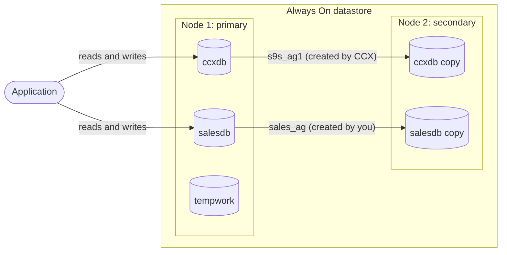
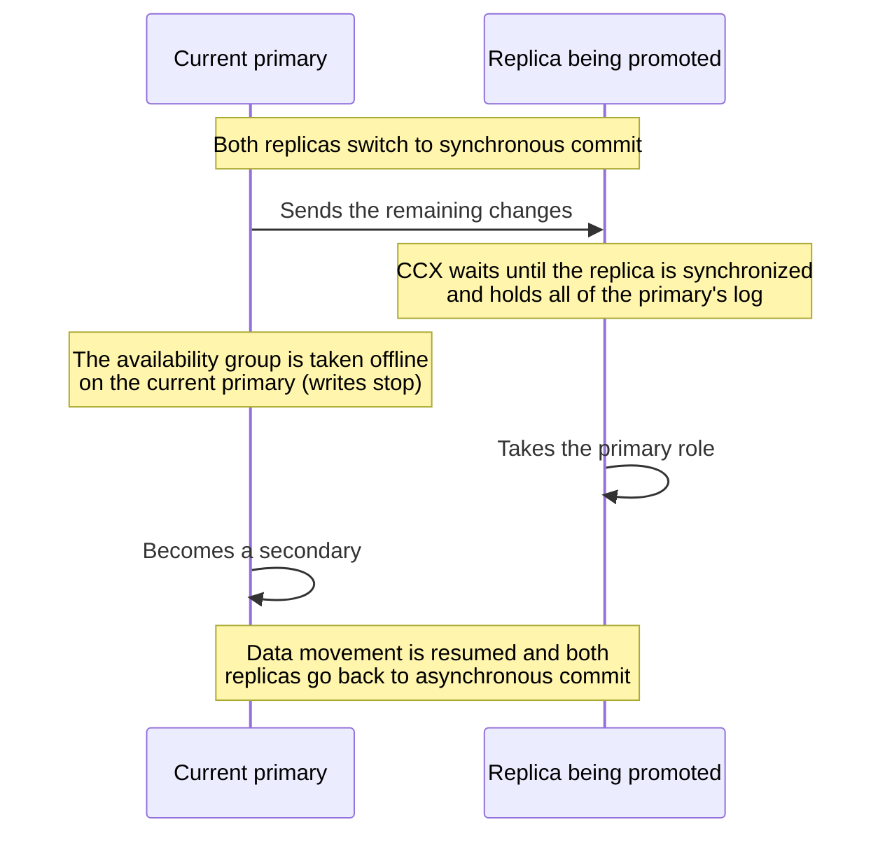

# Always On

From version 1.58.

This page describes how availability groups work in the Always On configuration: which databases CCX manages, how to make your own databases highly available, and what CCX does with every availability group when nodes are added, removed, promoted or repaired.

:::warning

An Always On datastore cannot be converted to a single-node (standalone) datastore. To move to a standalone datastore, create a new standalone datastore and move the databases into it, for example by restoring a backup of each database into the new datastore.

:::

## Databases and availability groups

An availability group keeps a database highly available: every node of the datastore holds a copy (a replica) of it.

- One node is the **primary** of the availability group. Applications read from and write to the database on the primary.
- The other nodes are **secondaries**. They receive a copy of every change from the primary.

**What CCX manages:** when the datastore is deployed, CCX creates the database `ccxdb` in an availability group named `s9s_ag1`. CCX keeps `s9s_ag1` on every node.

**What you manage:** further databases and availability groups are created and dropped by you, directly in SQL Server with T-SQL. CCX does not create or drop databases or availability groups in the Always On configuration. Once a database is in an availability group, CCX looks after that availability group as described on this page.



In this example, `ccxdb` and `salesdb` are highly available. `tempwork` is in no availability group: it exists only on node 1, and it is lost if node 1 fails or is replaced.

:::warning

A database that is in no availability group is not replicated. It exists only on the node where it was created, and it is lost on a failover, an automatic repair or a node replacement. Put every database you create into an availability group.

:::

All availability groups use **asynchronous commit**. The primary does not wait for the secondaries before it confirms a transaction, so writes are not slowed down by the replicas. A secondary is normally a little behind the primary.

## Editions

The edition of SQL Server decides how availability groups behave:

| | Standard | Enterprise |
|---|---|---|
| Databases per availability group | One | Several |
| Secondary readable | No: connect to the primary for reads and writes | Yes |

CCX applies the standard license unless your CCX installation is configured otherwise. With the standard license, create one availability group for each database.

## Creating your own availability group

An availability group that CCX can look after must look like `s9s_ag1`:

- a replica on every node of the datastore, with the same replica names and endpoints as `s9s_ag1`
- `CLUSTER_TYPE = NONE`
- asynchronous commit, manual failover and automatic seeding

Find the replica names and endpoints of your datastore with this query:

```sql
SELECT r.replica_server_name, r.endpoint_url
FROM sys.availability_replicas r
JOIN sys.availability_groups g ON g.group_id = r.group_id
WHERE g.name = 's9s_ag1';
```

Then, with the replica names of your datastore in place of `db-aaaaa-int` and `db-bbbbb-int`, and the primary's replica listed first:

1. On the primary, create the database. An availability group needs the database in the full recovery model, with a full backup taken:

    ```sql
    CREATE DATABASE salesdb;
    ALTER DATABASE salesdb SET RECOVERY FULL;
    BACKUP DATABASE salesdb TO DISK = N'/var/opt/mssql/data/salesdb.bak' WITH INIT;
    ```

2. On the primary, create the availability group:

    ```sql
    CREATE AVAILABILITY GROUP [sales_ag]
      WITH (CLUSTER_TYPE = NONE)
      FOR DATABASE salesdb
      REPLICA ON
        N'db-aaaaa-int' WITH (ENDPOINT_URL = N'tcp://db-aaaaa-int:5022',
          AVAILABILITY_MODE = ASYNCHRONOUS_COMMIT, FAILOVER_MODE = MANUAL,
          SEEDING_MODE = AUTOMATIC, SECONDARY_ROLE (ALLOW_CONNECTIONS = NO)),
        N'db-bbbbb-int' WITH (ENDPOINT_URL = N'tcp://db-bbbbb-int:5022',
          AVAILABILITY_MODE = ASYNCHRONOUS_COMMIT, FAILOVER_MODE = MANUAL,
          SEEDING_MODE = AUTOMATIC, SECONDARY_ROLE (ALLOW_CONNECTIONS = NO));
    ```

3. On each secondary, join the availability group and allow it to receive the database:

    ```sql
    ALTER AVAILABILITY GROUP [sales_ag] JOIN WITH (CLUSTER_TYPE = NONE);
    ALTER AVAILABILITY GROUP [sales_ag] GRANT CREATE ANY DATABASE;
    ```

SQL Server then copies `salesdb` to the secondaries (automatic seeding).

Please note:

- Availability group names that start with `s9s_ag` are used by CCX. Choose another name for your own.
- Restoring a backup also puts a database that is in no availability group into one; see [Backup and Restore](./backup-restore.md).

## Adding a node

When a node is added, it joins every availability group whose primary is the datastore's primary: `s9s_ag1` and your own. SQL Server copies each database to the new node. The add node job waits until the new node is healthy in each of these availability groups.

## Promoting a replica

Promoting a replica makes it the new primary. CCX moves every availability group that has its primary on the current primary and holds a database. CCX moves each one without losing transactions:



Please note:

- The databases are unavailable to applications for a short moment while the roles change.
- If a replica does not become synchronized, that availability group is not moved and the promotion fails. Availability groups moved before it stay on the new primary.
- An availability group that has its primary on another node, or that holds no database, is not moved.
- Backups continue on the new primary. The first backup after the promotion is a full backup; see [Backup and Restore](./backup-restore.md).

## When the primary fails

If the primary fails, a replica can only take over with the changes it has already received. Because availability groups use asynchronous commit, the last transactions committed on the failed primary may not have reached the replica, and they are lost.

## Removing a node

Before a node is removed, CCX moves every one of your availability groups that has its primary on that node to another node, in the same way as a promotion, without losing transactions. The node then leaves every availability group.

The remove node job is refused, and says why, when:

- the node is the primary of `s9s_ag1`. Promote another node first, then remove the node.
- one of your availability groups has its primary on the node and cannot be moved, for example because it has no replica on another node.

A node that has failed and cannot be reached can be removed.

## Automatic repair

When a node fails, CCX can replace it with a new node. The new node joins the availability groups in the same way as when a node is added.

## Further reading

- [Backup and Restore](./backup-restore.md)
- [Limitations](./limitations.md)
