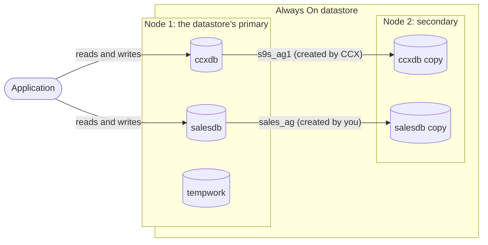
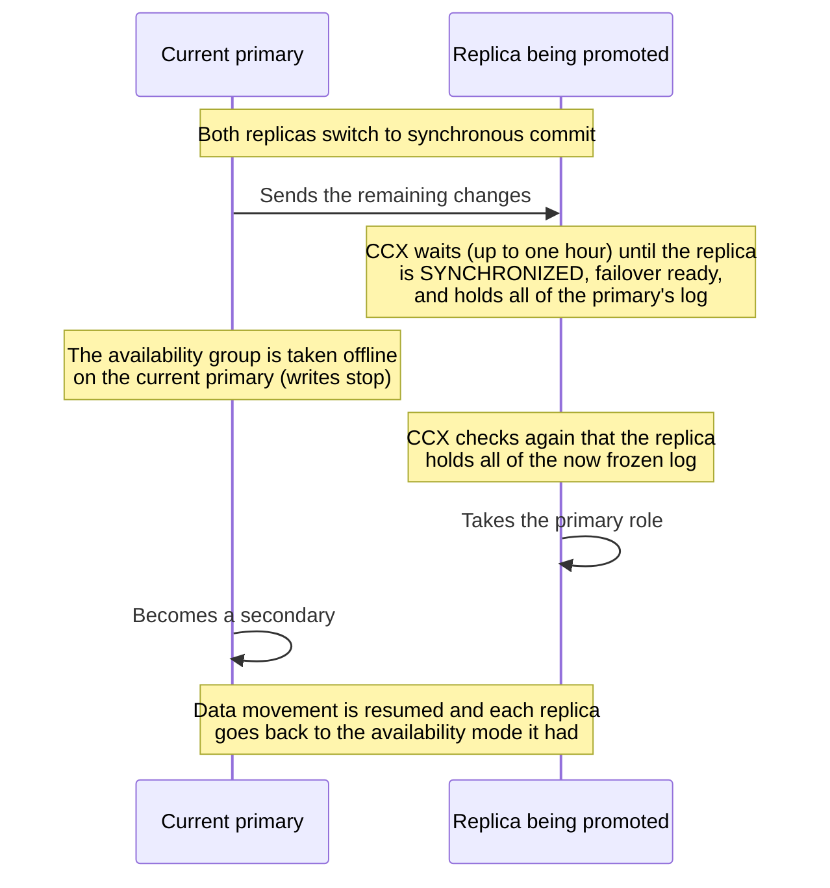

# Always On

From version 1.58.

This page describes how availability groups work in the Always On configuration: which databases and availability groups CCX manages, how to make your own databases highly available, and what CCX does with every availability group when the datastore is deployed, nodes are added, removed, promoted, repaired or upgraded, and when a node fails.

:::warning

An Always On datastore cannot be converted to a single-node (standalone) datastore. To move to a standalone datastore, create a new standalone datastore and move the databases into it, for example by restoring a backup of each database into the new datastore.

:::

## Terms used on this page

- **Availability group**: a SQL Server Always On availability group with `CLUSTER_TYPE = NONE` (no Windows or Pacemaker cluster manager). Every node of the datastore that is in the group holds a replica of its databases.
- **Primary** of an availability group: the replica that accepts reads and writes. The others are **secondaries**.
- **The datastore's primary**: the node that is the primary of `s9s_ag1`, the availability group CCX manages. CCX shows this node as the primary of the datastore.

## Databases and availability groups

**What CCX manages:** when the datastore is deployed, CCX creates the database `ccxdb`, takes a first backup of it, and adds it to an availability group named `s9s_ag1` with a replica on every node.

**What you manage:** you cannot create or drop databases or availability groups from the CCX UI or API in the Always On configuration. Create and drop them yourself, directly in SQL Server.

Once a database is in an availability group, CCX looks after that availability group as described on this page.

In this example, `ccxdb` and `salesdb` are highly available. `tempwork` is in no availability group: it exists only on node 1.

:::warning

A database that is in no availability group is not replicated. It exists only on the node where it was created. After a failover it stays on the old primary, which is then taken offline or removed, so applications can no longer reach it. It is backed up only while it is on the datastore's primary. Put every database you create into an availability group.

:::

Only **asynchronous commit** is supported: CCX creates and adds every replica with `AVAILABILITY_MODE = ASYNCHRONOUS_COMMIT`. The primary does not wait for the secondaries before it confirms a transaction, so a secondary is normally a little behind the primary. The exception is the short time of a promotion; see [Promoting a replica](#promoting-a-replica).

## Editions

The edition of SQL Server decides how availability groups behave:

| | Standard | Enterprise |
|---|---|---|
| Databases per availability group | One (basic availability group) | Several |
| Secondary readable | No (`ALLOW_CONNECTIONS = NO`): connect to the primary for reads and writes | Yes, when the replica has `ALLOW_CONNECTIONS = ALL` |

CCX applies the standard license unless your CCX installation is configured otherwise. CCX creates its own replicas with `ALLOW_CONNECTIONS = NO` on Standard and `ALLOW_CONNECTIONS = ALL` otherwise.

## Logins

An availability group replicates databases, not logins. A login that is missing on the node that becomes the primary makes applications fail to connect after a failover.

- Users created through CCX are created on every node with the same SID.
- When a node is added, CCX copies the logins from the datastore's primary to it.
- A login you create yourself with T-SQL exists only on the node where you created it. Create logins through CCX, or create them on every node with the same SID.

## Adding a node

When a node is added:

1. It joins `s9s_ag1` and receives `ccxdb` by automatic seeding. CCX waits until the new replica is healthy. If this fails, the new node is taken out of the availability groups again and the job fails.
2. It joins every other availability group that has its primary on one of the existing nodes, with `AVAILABILITY_MODE = ASYNCHRONOUS_COMMIT`, `FAILOVER_MODE = MANUAL`, `BACKUP_PRIORITY = 50`, `SEEDING_MODE = AUTOMATIC` and `ALLOW_CONNECTIONS = NO` (Standard) or `ALL` (Enterprise). For each one that holds a database, CCX waits up to one hour for the new replica to become healthy. An availability group without a database is joined but not waited for.
3. The logins of the datastore's primary are copied to the new node.

If the new node cannot join one of your availability groups, the job still succeeds. The job log has a warning naming the availability group, the new replica is removed from it again, and that group has no copy on the new node.

## Promoting a replica

Promoting a replica makes it the new primary. A promotion is lossless: no committed transaction is lost.

CCX moves every availability group that has its primary on the datastore's primary, holds a database, and has a replica on the node being promoted. For each one, CCX makes sure the replica has everything before it changes the roles:

While CCX waits, both replicas run with `SYNCHRONOUS_COMMIT`, so commits on the primary wait for the replica.

If any of these checks fails, the replica is not promoted: the current primary stays the primary and each replica goes back to the availability mode it had. In the rare case that the replica's role cannot be determined after the role change was requested, the job stops and says that manual attention is needed, rather than risk two primaries.

Please note:

- The databases are unavailable to applications for a short moment while the roles change.
- The availability groups are moved one after another, in no fixed order. If one of them cannot be moved, the promotion fails and the groups moved before it stay on the new node. `s9s_ag1` and your own availability groups can then have their primaries on different nodes.
- An availability group that has its primary on another node, that holds no database, or that has no replica on the node being promoted, is not moved. If `s9s_ag1` holds no database, it is not moved either.
- Backups continue on the new primary. The first backup after the promotion is a full backup; see [Backup and Restore](./backup-restore.md).

## When a node fails

CCX fails over automatically only when automatic recovery is enabled for the datastore, and never for a datastore or a failed node that is in maintenance. CCX first checks the failed node again over a few more monitoring rounds, so a short interruption does not cause a failover.

### When the datastore's primary fails

When the datastore's primary has failed, CCX fails over to the replica that is least behind.

This failover is not lossless:

- For each availability group that has its primary on the failed node, holds a database, and has a replica on the chosen node (including your own availability groups), CCX runs `ALTER AVAILABILITY GROUP ... FORCE_FAILOVER_ALLOW_DATA_LOSS` on the chosen node and waits until its databases are ONLINE.
- Because commit is asynchronous, transactions that the failed primary had committed but not yet sent to the replica are lost. Normally these are the transactions of the last moments before the failure.
- CCX then removes the failed node's replica from those availability groups. Until the failed node is replaced, the databases have one replica and are not highly available.
- Availability groups led by another node that is still running keep their primary.

### When another node fails

When a node that is not the datastore's primary fails, and it was the primary of some of your availability groups, CCX fails over each of those that holds a database:

- The new primary is the datastore's primary if it holds a replica of the availability group, otherwise the surviving replica furthest ahead in the log.
- CCX runs `ALTER AVAILABILITY GROUP ... FORCE_FAILOVER_ALLOW_DATA_LOSS` there. Transactions the failed node had not yet sent to that replica are lost, as with any automatic failover under asynchronous commit.
- CCX removes the failed node's replica from the availability group, and makes its other replicas synchronize with the new primary.
- An availability group whose failover fails does not stop the others; the job fails and names it.

### When the old primary comes back

If a node whose availability groups were failed over comes back and still reports itself as primary of one of them, CCX fences it so that it cannot accept writes next to the new primary:

- its availability groups are set `OFFLINE` on that node
- SQL Server is stopped on that node
- the node is put into maintenance for 30 days
- a critical split-brain alarm is raised

The transactions the new primary never received exist only on that node. If you need them, contact support before the node is removed.

## Removing a node

Before a node is removed, CCX moves every one of your availability groups that has its primary on that node to another node, in the same way as a promotion, without losing transactions. The datastore's primary is preferred as the target. The node then leaves every availability group.

The remove node job is refused, and says why, when:

- the node is the datastore's primary (the primary of `s9s_ag1`). Promote another node first, then remove the node.
- one of your availability groups has its primary on the node and cannot be moved, for example because it has no replica on another connected node.
- SQL Server on the node does not answer but the node answers SSH: SQL Server may still be running there as the primary of an availability group.

A node where neither SQL Server nor SSH answers is removed. The availability groups it was the primary of are failed over first, in the same way as when a node fails: forced, to the datastore's primary if it holds a replica, otherwise to the replica furthest ahead in the log, so transactions the node had not yet sent are lost. If one of them cannot be failed over, the removal fails.

## Automatic repair

When a node fails, CCX can replace it with a new node. With the standard license (two nodes), CCX removes the failed node first and then adds the new one, so the datastore runs on one node in between, and the rules of [Removing a node](#removing-a-node) apply. The new node joins the availability groups as described in [Adding a node](#adding-a-node).

## Upgrade

An upgrade replaces each node with a new one, the secondaries before the primary.

With the standard license and two nodes:

1. The secondary is removed, then a new node is added.
2. The new node is promoted, losslessly; the databases are briefly unavailable.
3. The old primary, now a secondary, is removed, then a new node is added.

The datastore runs on one node, without high availability, while a node is being replaced. In other configurations, each new node is added before the node it replaces is removed, and a new node is promoted before the old primary is removed.

If a new node could not join one of your availability groups, the promotion does not move that group, and removing the old primary, which is still its primary, is refused.

## Further reading

- [Backup and Restore](./backup-restore.md)
- [Limitations](./limitations.md)
