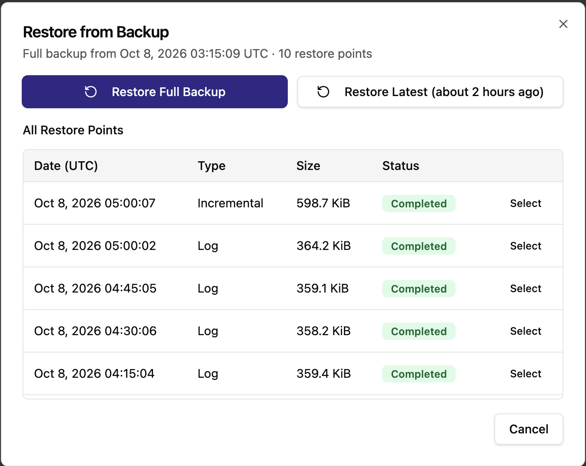
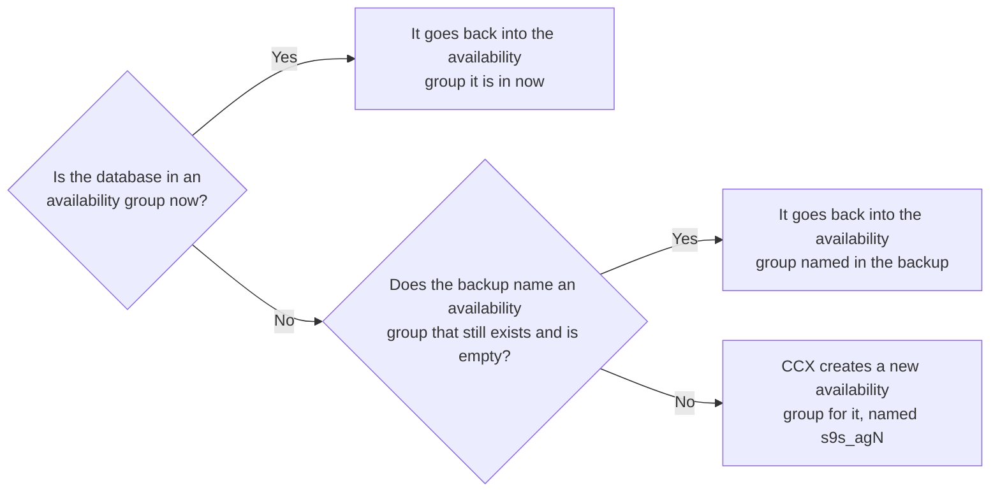

# Backup and Restore

CCX backs up Microsoft SQL Server with SQL Server's own native backup, streamed directly to S3 storage. Native S3 streaming was introduced in CCX 1.58.

## Backup

### How backups are taken

Backups use SQL Server's `BACKUP ... TO URL`, which writes the backup straight to S3 storage:

- Nothing is written to the database server's disk first, and there is no separate upload step. A backup is complete when SQL Server has finished writing it to S3.
- Every backup is compressed, encrypted (AES-256) and checksummed by SQL Server.
- Each database is written to its own object, so a backup of a datastore with several databases contains one file per database.
- In the Always On configuration, each database is backed up on the primary of its availability group; see [Backups in the Always On configuration](#backups-in-the-always-on-configuration). After a failover, backups continue on the new primary.

### Backups in the Always On configuration

From version 1.58.

A backup covers every database of the datastore, wherever its availability group has its primary:

- A database in an availability group is backed up on the primary of that availability group.
- A database in no availability group is backed up only if it is on the datastore's primary (the node that is the primary of `s9s_ag1`). A database in no availability group on a secondary is not backed up.
- The backup records which availability group each database was in.

The backup fails, and names the databases, when:

- the primary of an availability group cannot be reached.
- the same database name is used in two availability groups, or inside an availability group and outside one on different nodes. Database names must be unique across the datastore.

See [Always On](./always-on.md) for databases and availability groups.

### Backup types and schedule

Three backup types are used together:

| Type | What it contains | Default schedule |
|---|---|---|
| Full | The complete database | Once a day |
| Differential (shown as "incremental" in the backup schedule) | Changes since the last full backup | Every hour |
| Log | The transaction log since the previous log backup | Every 15 minutes |

The log backups determine how much data can be lost: with the default schedule, there is normally a restore point about every 15 minutes.

The backup schedule can be tuned and backups can be paused.

### After a failover or a restore

The first backup taken on a new primary after a failover is always a full backup, even if a differential or log backup was scheduled.

The first backup taken after a restore is also a full backup, even if a differential or log backup was scheduled. The restored databases no longer continue the chain of backups taken before the restore, so a new chain is started from a full backup.

Normal scheduling continues after that.

### Deleting backups

When a backup is deleted, either manually or because it has passed the retention period, its files are removed from S3 storage.

## Restore

### Restore a backup on the existing datastore

Restoring starts from a full backup. The **Restore from Backup** dialog lists the full backup and every restore point taken after it: the differential backups (shown as *Incremental*) and the log backups.

- **Restore Full Backup** restores the full backup only.
- **Restore Latest** restores the newest restore point in the list.
- **Select** on a row restores up to that restore point.

CCX builds the sequence SQL Server needs to reach the chosen point and restores it on the primary (in the Always On configuration, the primary of each database's availability group; see below):

- **Full backup:** the full backup only.
- **Differential backup:** the full backup, then the chosen differential backup.
- **Log backup:** the full backup, then the most recent differential backup taken after the full backup and before the chosen log backup (if there is one), then every log backup after that up to and including the chosen one.

Choosing a log backup restores the database to the moment that log backup was taken.

The backup files are read directly from S3 storage.

### Restore in the Always On configuration

From version 1.58.

In the Always On configuration, each database is restored on the node that is the primary of its availability group when the restore starts. This does not have to be the node that took the backup: any node can read the backup from S3 storage. A database in no availability group is restored on the datastore's primary.

Every node must be reachable; otherwise nothing is restored. During the restore:

- The restored databases leave their availability groups. The availability groups they are in, including your own, are switched to `SEEDING_MODE = MANUAL`, and back to `AUTOMATIC` afterwards, also when the restore fails.
- A restored database that is in no availability group has its copies on the secondaries dropped, because automatic seeding refuses a database the replica already has.
- A database that was backed up in the `SIMPLE` recovery model is switched to `FULL`, and a database that was backed up `READ_ONLY` is set `READ_WRITE`, because an availability group needs both.

When the restore finishes, every restored database is in an availability group with a replica on every node, and is healthy on each of them. Which availability group a database goes into:

- A database that is in an availability group goes back into the availability group it is in now, even if the backup names another one.
- A database that is in no availability group, for example because an earlier restore was interrupted, goes back into the availability group named in the backup, if that availability group still exists and holds no database. Run an interrupted restore again: the databases go back into their availability groups.
- Otherwise CCX creates a new availability group for the database, named `s9s_agN` (for example `s9s_ag4`), with a replica on every node and CCX's replica settings (see [Always On](./always-on.md#adding-a-node)). When the backup names an availability group that could not be used, the job log says why.

As a side effect, a restore puts a restored database that was in no availability group into an availability group of its own, which makes it highly available.

Please note:

- A restore replaces the current contents of the restored databases. Data written after the chosen backup is lost.
- The databases are unavailable to applications while the restore runs.
- Backups taken before a failover can be restored after it, on the new primary.

### Backups taken before CCX 1.58

Backups taken before CCX 1.58 (written to disk first and then uploaded) can still be restored. CCX downloads them to the primary before restoring them. A restore sequence may mix both kinds, for example an older full backup followed by newer differential and log backups.
